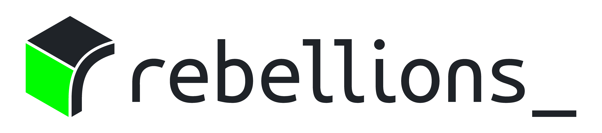

<div align="center">

<picture>
  <source media="(prefers-color-scheme: dark)" srcset="rbln-model-zoo-banner.png">
  
</picture>

*500+ models · Compile once, run anywhere · AI model serving on RBLN NPUs*

# RBLN Model Zoo

[](https://rebellions.ai/developers/model-zoo)
[](https://docs.rbln.ai)

[](https://docs.rbln.ai/supports/version_matrix.html)
[](https://docs.rbln.ai/supports/version_matrix.html)
[](https://docs.rbln.ai/supports/version_matrix.html)
[](https://docs.rbln.ai/supports/version_matrix.html)

</div>

---

## Quick Start

The `rbln-zoo` CLI **discovers** models; each model is **run from its own directory**.

**1. Discover** — install the CLI and browse the catalog:

```bash
git clone https://github.com/RBLN-SW/rbln-model-zoo.git && cd rbln-model-zoo
uv pip install -e .

rbln-zoo list -s llama      # search the catalog
rbln-zoo cards              # show card types
```

**2. Run** — from the model's directory, install its dependencies and execute:

```bash
cd Rebel100/huggingface/transformers/text2text-generation/llama/llama3.1-8b
uv pip install -r requirements.txt
python compile.py && python inference.py     # single-file examples: python main.py
```

Every example lives under the product it targets — `Rebel100/` for Rebel100™ (`RBLN-CR13`),
`ATOM/` for ATOM™+ and ATOM™-Max. A `Rebel100/` example is its `ATOM/` counterpart retuned for a
single NPU, so swapping the leading directory is usually all it takes to move between them.

> [!IMPORTANT]
> Compilation requires the RBLN Compiler from RBLN's private package index.
> See the [installation guide](https://docs.rbln.ai/latest/getting_started/installation_guide.html).

---

## CLI

`rbln-zoo` browses and filters the model catalog; it does not compile or run models.

```bash
rbln-zoo list -c RBLN-CR13 -t text2text-generation -s qwen   # filter by card, task, keyword
rbln-zoo cards                                               # card types and counts
```

| Command | Description | Flags |
|:--------|:------------|:------|
| `list` | Browse and filter models | `-c` card · `-f` framework · `-t` task · `-s` search · `-r` refresh |
| `cards` | Show card types and counts | `-r` refresh |
| `config` | Read or write persistent CLI defaults | subcommands `set` · `get` · `unset` · `list` · `path` |

`list` prints a table, which elides long paths. `--paths` prints one full model path per
line instead — for a shell pipeline, or to copy — and `--json` prints the full entries.

The catalog is cached against the current commit and `model_registry.yaml`, so it
refreshes itself once a change is committed. Pass `-r` to pick up a model that is not.

### Card types

Models are tagged with RBLN product cards — `RBLN-CR13` (Rebel100™), `RBLN-CA22` (ATOM™+) and
`RBLN-CA25` (ATOM™-Max) — per the
[version matrix](https://docs.rbln.ai/latest/supports/version_matrix.html).
Each product tree carries its cards by default: models under `Rebel100/` are tagged
`RBLN-CR13`, models under `ATOM/` are tagged `RBLN-CA22`/`RBLN-CA25`.
Matching is case-insensitive and honors aliases declared in
[`model_registry.yaml`](model_registry.yaml).

<details>
<summary>Example — adding a card with aliases</summary>

```yaml
cards:
  RBLN-CA22:
    description: "ATOM™+"
  RBLN-CA25:
    description: "ATOM™-Max"
  RBLN-CR13:
    description: "Rebel100™"
  CX:
    description: "Next-gen NPU"
    aliases: [RBLN-CX01]   # -c RBLN-CX01 resolves to CX

default_cards:            # per product tree (top-level directory)
  ATOM: [RBLN-CA22, RBLN-CA25]
  Rebel100: [RBLN-CR13]

overrides:
  ATOM/huggingface/transformers/.../model-a:
    cards: [RBLN-CA25, CX]
```

</details>

---

## Ecosystems

| Ecosystem | Models | Key packages |
|:----------|:-------|:-------------|
| Hugging Face | 150+ | transformers, diffusers |
| PyTorch | 250+ | torch |
| TensorFlow | 75+ | keras, tensorflow |

> [!NOTE]
> Model counts are approximate, as of 2026-07-13 — see the [Model Zoo](https://rebellions.ai/developers/model-zoo) for the live catalog.

**C API** — C/C++ inference bindings; install via
[APT](https://docs.rbln.ai/software/api/language_binding/c/installation.html), then build from source.

---

## Deployment

Compile a model, then serve it on a supported inference server.

### vLLM RBLN

A single `vllm serve` compiles the model on first run and serves the OpenAI-compatible API — no
separate `compile.py` step.

```bash
uv pip install \
  --extra-index-url https://wheels.vllm.ai/0.30.0/cpu \
  --torch-backend cpu \
  vllm-rbln
```

On Rebel100™, one NPU serves Llama-3.1-8B-Instruct:

```bash
vllm serve meta-llama/Llama-3.1-8B-Instruct \
  --model-impl transformers \
  --rbln-num-devices-per-local-rank 1 \
  --served-model-name Llama-3.1-8B-Instruct \
  --max-model-len 32768 \
  --block-size 8192 \
  --max-num-seqs 1
```

```bash
curl http://localhost:8000/v1/chat/completions \
  -H "Content-Type: application/json" \
  -d '{
    "model": "Llama-3.1-8B-Instruct",
    "messages": [{"role": "user", "content": "Hello"}],
    "max_tokens": 32
  }'
```

`--rbln-num-devices-per-local-rank` is how many NPUs the model is partitioned across. ATOM™ runs
the same model across 8 with a 131,072-token window (`--max-model-len 131072 --block-size 16384`).

> [!NOTE]
> Per-model serve commands live in the [vLLM RBLN recipes](https://docs.rbln.ai/software/model_serving/vllm_support/vllm-rbln.html) — see them for the engine arguments a given model needs.

### Other serving options

- **[NVIDIA Triton Inference Server](https://docs.rbln.ai/software/model_serving/nvidia_triton_inference_server/installation.html)** — multi-model inference
- **[TorchServe](https://docs.rbln.ai/software/model_serving/torchserve/torchserve.html)** — PyTorch model serving

---

## Links

- [CHANGELOG](CHANGELOG.md) — release history
- [Issues](https://github.com/RBLN-SW/rbln-model-zoo/issues) — report bugs, request features or new models
